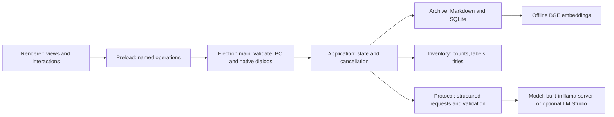

# How Aletheia works

The desktop has one sandboxed page and one privileged main process. The main process owns the archive and a single optional inference child. It never needs SillyTavern or a separate Python service.

## Code map

| File | Responsibility |
| --- | --- |
| `src/main.js` | Start Electron, choose per-user data paths, validate IPC senders, show native file dialogs, close owned resources. |
| `src/preload.cjs` | Expose named functions to the isolated renderer without giving it Node or arbitrary IPC access. |
| `src/application.js` | Coordinate operations, cancellation, snapshots, preferences, history, imports, drafts and retrieval. |
| `src/archive.js` | Maintain authoritative Markdown and a derived SQLite/FTS/vector index; preserve IDs; save and rename atomically. |
| `src/inventory.js` | Recognize collection-wide questions and format real archive totals and bounded title examples. |
| `src/embeddings.js` | Load local BGE q8 weights and split original text into token-bounded, overlapping passages. |
| `src/model.js` | Start/stop an owned local engine, try GPU then CPU, or connect to optional LM Studio; request the selected model ID and manage portable response formats. |
| `src/runtime.js` | Select Windows/Linux executable names and the development/packaged runtime layout. |
| `src/protocol.js` | Build bounded prompts and validate complete structured answers, source IDs and document metadata. |
| `src/api.js`, `src/gguf.js` | Build portable Chat Completions requests, classify HTTP format errors, and validate user-selected GGUF containers. |
| `src/config.js`, `src/download.js` | Validate/atomically persist preferences; resume and verify large downloads. |
| `renderer/app.js` | Render text safely, preserve in-progress edits, manage controls, title dialogs and theme interactions. |
| `renderer/theme.js`, `renderer/style.css` | Apply cached theme before first paint; define light/dark semantic colors. The saved main-process setting is authoritative. |
| `scripts/prepare-assets.js` | Download pinned runtime/search assets, verify hashes, extract safe paths, prepare icons and licenses. |
| `packaging.cjs`, `scripts/build.js` | Select target-specific assets/dependencies and build Electron without mixing Windows and Linux native libraries. |
| `scripts/package-linux.js` | Stream a Debian installer with Unix ownership, executable modes, system dependencies and a desktop launcher. |
| `scripts/inspect-linux-package.js` | Independently read back the installer and check archive structure, native binaries, permissions and launcher. |
| `.github/workflows/release.yml`, `scripts/publish-release.js` | Build/check native installers from a version tag, create corresponding source/checksums, verify uploaded assets and publish the completed draft release. |

## Archive overview versus topical search

“What does my archive contain?” asks about the collection as a whole. A semantic search for the words “archive” and “contain” is liable to miss every record. `isInventoryQuestion()` recognizes broad forms and keeps its patterns anchored so “what does my archive contain about bicycles?” remains a topical query.

After refreshing the index, `Archive.inventory()` counts **all** indexed records in SQL. It groups document types, counts explicit metadata topic labels, and selects up to 12 recent title examples. `formatInventory()` turns those facts into a response with real source IDs. It does not ask the language model to guess counts or infer unseen topics. Empty archives receive a direct empty message. Index errors propagate instead of being mistaken for an empty collection.

Topical questions follow the existing retrieval path: stemmed FTS and BGE cosine scores are fused, selected original passages are fitted to the context budget, and the selected AI must return one complete JSON answer citing supplied source IDs. A topical no-match message offers a title/keyword retry or the archive overview. Retrieval never proves that an unreturned document does not exist.

## Data and consistency

`knowledge/*.md` is the authoritative archive. SQLite is a derived index. Scans skip unchanged hashes, generate replacement vectors before committing a changed document, and reject duplicate IDs. Async archive operations share a queue. Application operations share a cancellation controller and publish busy state to the UI.

Title edits carry a document revision. Both the indexed hash and current file hash must match before atomic replacement, so a stale dialog cannot overwrite an external change. Renaming preserves the ID, filename, creation date and body. Only the final outer Metadata section is updated when the body itself quotes another record.

Prepare document generates small metadata fields and retains the complete original text. Long sources may be excerpted only for metadata generation. The user reviews the draft and explicitly saves it. A failed or cancelled model response is never automatically archived.

## Platform boundaries

Development assets live under `resources/runtime/win32-x64/` and `resources/runtime/linux-x64/`. Each installer copies only its target into `resources/aletheia/runtime/`. Windows starts `llama-server.exe`; Linux starts `llama-server` with its library directory scoped to that child. A failed Vulkan start falls back to CPU. Only the owned child is stopped when Aletheia exits; external LM Studio servers remain under their owner's control.

Linux dependencies are selected with npm's Linux/glibc target when cross-building. Native ONNX and sharp packages remain outside ASAR. The `.deb` installs application files as root under `/opt/Aletheia`, registers a launcher, and configures Chromium's sandbox. User archives/settings are stored separately in Electron's per-user config directory and are left in place on uninstall.

## Model compatibility

Qwen is the default downloadable model, not the identity of the application. `Config` migrates legacy `lmstudio` profiles to `api` and preserves their endpoint, credentials, selected file and theme. API settings include a model ID, response mode and output-limit parameter. Discovery uses unsaved connection fields and is optional; a missing `/models` route does not prevent manual-ID connections.

The local engine exposes one application-owned alias (`aletheia-local`) for whichever GGUF was selected. The file header is checked before replacing a selection; llama.cpp checks architecture/tensors/chat-template compatibility during loading. The pinned default Qwen filename retains its verified no-thinking options. Other models use their own embedded chat template without that Qwen override. An unsupported architecture or insufficient memory produces a visible load error.

External requests include only the model, messages, output limit, streaming disabled and the selected response format. No Qwen-specific reasoning or tool parameters are sent. The selected ID is always requested; versioned IDs returned by provider aliases are allowed. HTTP redirects are rejected so the configured credential is sent only to the chosen endpoint. The actual completion still passes the original structure, completion, tool-call and source-ID checks.

Automatic format negotiation can advance from schema to JSON to prompt only after an explicit HTTP format rejection, or a local grammar/sampler initialization failure before generation. The successful mode is cached until reconnection. Prompt/JSON modes carry the full schema in trusted instructions. There is no retry for an authentication/quota failure or malformed completed answer. The Archivist's existing one-retry metadata-validation policy is separate; nothing is auto-saved. Context accounting includes the adapted messages on every attempt.

Generation selection does not affect the BGE embeddings, chunking or index signature. Changing models therefore preserves archive retrieval and original Markdown.

## Verification

`npm test` uses temporary profiles and deterministic fake embeddings/model responses for regression checks. `scripts/desktop-smoke.js` exercises the real renderer/preload in development, including an overview without a configured model. `--verify-archive` checks a packaged app with real local search in an empty isolated profile. `--verify-installation` additionally loads the configured AI model. Real-model smoke scripts use synthetic records and never the normal archive.

## Original project and license scope

The upstream Archivist/Binder/Librarian workflow and covered prompts originate in [Adeptus Telvannus’s Aletheia](https://github.com/AdeptTel1/Aletheia). See ATTRIBUTION.md for material changes, UPSTREAM-PROVENANCE.json for source hashes, and LICENSING.md for the custom upstream terms and separate contribution/dependency licenses. The framework/implementation lineage does not replace original-author attribution.
